<div align="center">

# Santhosh M K

[](https://github.com/devsanthoshmk?tab=repositories)
[](https://github.com/devsanthoshmk)

<picture>
  <source media="(prefers-color-scheme: dark)" srcset="https://raw.githubusercontent.com/devsanthoshmk/devsanthoshmk/main/dark.svg">
  <source media="(prefers-color-scheme: light)" srcset="https://raw.githubusercontent.com/devsanthoshmk/devsanthoshmk/main/light.svg">
  
</picture>

</div>

---

## Technical Summary

Full-stack and AI systems engineer focused on autonomous agent workflows, Model Context Protocol (MCP) integrations, distributed backends, and high-throughput data extraction engines. Creator of production developer tools and serverless architectures with 78+ repositories spanning Python, TypeScript, Go, and Vue/React.

---

## Flagship Systems & Repositories

### AI Systems, MCP & Autonomous Agents

- **[gmaps-mcp](https://github.com/devsanthoshmk/gmaps-mcp)**
  Model Context Protocol (MCP) server providing Google Maps search, places details, and geospatial tools to LLMs and coding agents.
  - *Tech:* Python, FastMCP, Google Maps Places API, JSON-RPC.

- **[AgenticragChatbot](https://github.com/devsanthoshmk/AgenticragChatbot)**
  Multi-layer Agentic RAG pipeline and conversational agent with contextual chunking, vector indexing, and relational metadata persistence.
  - *Tech:* Node.js, Express, LangChain, Cohere, Groq, Qdrant Vector DB, Neon Postgres.

- **[skills](https://github.com/devsanthoshmk/skills)**
  Curated collection of production skills for autonomous AI coding agents, including headless subagent delegation, automated workflows, and terminal integrations.
  - *Tech:* Markdown, Shell, Custom Agent Protocols.

- **[agy-subagent](https://github.com/devsanthoshmk/agy-subagent)**
  Headless CLI subagent delegator and routing engine designed for decoupled terminal tasks and multi-tier LLM execution.
  - *Tech:* Antigravity CLI, Shell, JSON streams.

---

### Infrastructure, Tunnels & Distributed Services

- **[cloudflaredjs](https://github.com/devsanthoshmk/cloudflaredjs)**
  Zero-dependency Node.js wrapper for `cloudflared` to provision, manage, monitor, and maintain persistent Cloudflare Quick Tunnels programmatically.
  - *Tech:* Node.js, Cloudflare Tunnel Daemon, Child Process IPC, Stream Parsing.

- **[m14u-workers-v4](https://github.com/devsanthoshmk/m14u-workers-v4)**
  Serverless edge microservices powering multi-tenant routing, request validation, and proxy caching.
  - *Tech:* TypeScript, Cloudflare Workers, KV Storage, Edge Routing.

- **[no_socket_proxy](https://github.com/devsanthoshmk/no_socket_proxy)**
  Lightweight HTTP proxy service engineered for low-overhead streaming responses without WebSocket complexity.
  - *Tech:* Node.js, HTTP Streaming, Reverse Proxy.

---

### High-Throughput Scrapers & Data Pipelines

- **[gmapScraper](https://github.com/devsanthoshmk/gmapScraper) / [mapScraper.js](https://github.com/devsanthoshmk/mapScraper.js)**
  Scalable Google Maps business intelligence extraction pipelines featuring proxy rotation, resilient schema parsing, and automatic fallback routing.
  - *Tech:* Python, Node.js, Playwright, Puppeteer, Pandas.

- **[places-data-app](https://github.com/devsanthoshmk/places-data-app)**
  Cross-platform mobile and desktop data browser for harvested geospatial datasets with local filtering, phone validation, and Excel export.
  - *Tech:* Vue 3, Ionic, Capacitor, Vite, Android/iOS build targets.

- **[linkedin-companies-scraper.py](https://github.com/devsanthoshmk/linkedin-companies-scraper.py)**
  Automated enterprise lead generation script extracting structured corporate data, employee counts, and contact metadata.
  - *Tech:* Python, Requests, BeautifulSoup, CSV pipelines.

---

### Full-Stack Applications & Productivity Tools

- **[spacefurnio](https://github.com/devsanthoshmk/spacefurnio)**
  Modern interior design showcase and furniture catalog with interactive room rendering and cart flow.
  - *Tech:* Vue 3, Vite, Tailwind CSS.

- **[WA-automation](https://github.com/devsanthoshmk/WA-automation)**
  Scripted WhatsApp messaging pipeline with scheduled broadcasts, progress tracking, and batch dispatching.
  - *Tech:* JavaScript, Node.js, WhatsApp Web API.

- **[InstaDe-tox](https://github.com/devsanthoshmk/InstaDe-tox)**
  Chrome extension that removes algorithmic feeds and short-form video reels to prevent distraction.
  - *Tech:* JavaScript, Chrome Extension Manifest V3.

---

## Technical Skill Matrix

```text
Languages     : Python, TypeScript, JavaScript, Go, C++, SQL, HTML5/CSS3, Bash
AI & Agents   : Model Context Protocol (MCP), LangChain, Qdrant Vector DB, Groq, Cohere, RAG
Backend       : FastAPI, Node.js, Express, Cloudflare Workers, Flask, REST APIs, JSON-RPC
Databases     : PostgreSQL, Neon Serverless DB, Redis, MongoDB, SQLite
Frontend      : React, Next.js, Vue.js, Ionic Framework, Tailwind CSS, Vite
DevOps & Tool : Docker, Linux (Arch/Debian), Git, GitHub Actions, Cloudflare, Playwright
```

---

## Activity & Metrics

<div align="center">


<br>


</div>

---

## Connect & Contact

- GitHub: [@devsanthoshmk](https://github.com/devsanthoshmk)
- Email: [devsanthoshmk@gmail.com](mailto:devsanthoshmk@gmail.com)
